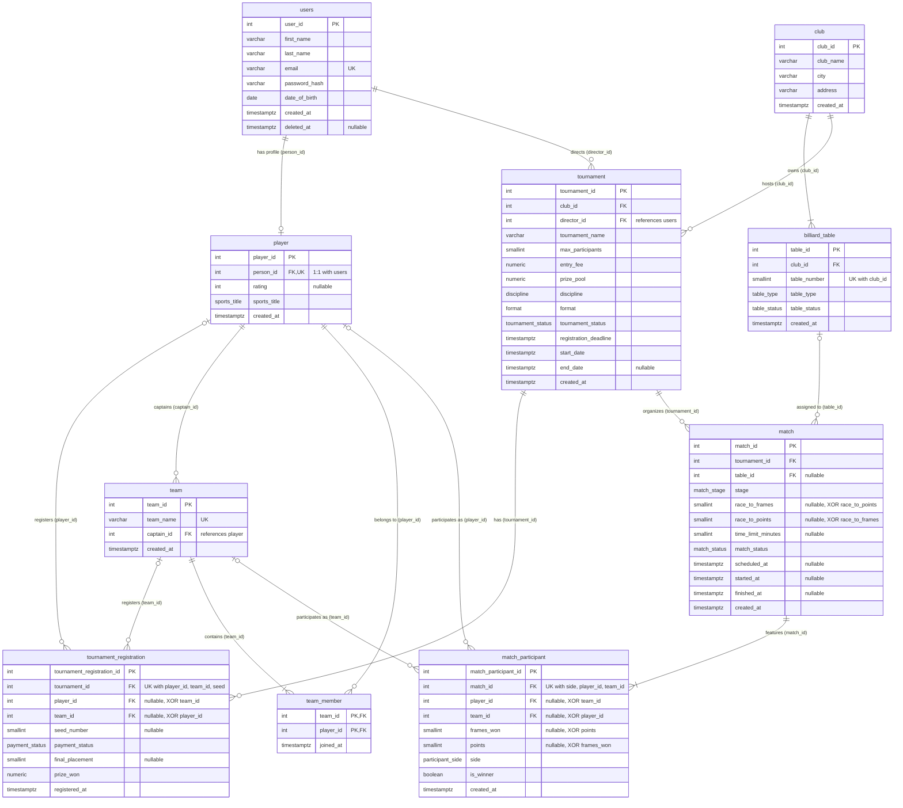

# Відповідь моделі: Синхронізація ER-моделі з реляційною схемою PostgreSQL (Ітерація 3)

## Огляд змін третьої ітерації
У цій ітерації модель повністю синхронізована з фізичною схемою PostgreSQL, розробленою в межах курсу баз даних:
1. **Розкриття M:N через `team_member`**:
   - Зв'язок між `team` та `player` реалізовано через таблицю-з'єднання `team_member` зі складеним ключем `(team_id, player_id)` та міткою часу приєднання `joined_at`.
   - Додано відношення капітанства: `player ||--o{ team : "captains (captain_id)"`.
2. **Уточнення ідентифікаторів та полів**:
   - `player.person_id` посилається на `users.user_id` (зв'язок 1:1 зі збереженням SSOT та 3NF).
   - Атрибути імен сутностей перейменовано на недвозначні: `club_name`, `team_name`, `tournament_name`.
   - Поле `password` замінено на `password_hash` (безпека збереження облікових записів).
3. **Диференціація правил більярдних дисциплін**:
   - `race_to_frames` (для пулу, снукеру, піраміди) та `race_to_points` (для карамболю/straight pool) у `match`.
   - `frames_won` та `points` у `match_participant`.
   - `participant_side` ENUM для позиції за столом.
4. **Аудит та життєвий цикл**:
   - Додано `created_at timestamptz` до всіх таблиць.
   - Додано `deleted_at timestamptz nullable` у таблицю `users` для забезпечення м'якого видалення (soft delete).

---

## Mermaid ER Діаграма

## Відповідність критеріям прийняття (Acceptance Criteria)
1. **Валідність синтаксису**: Mermaid-код валідний, успішно проходить валідацію.
2. **Артефакт - діаграма**: Файл `model.mmd` та рендер `render.png` повністю відповідають реляційній схемі.
3. **Семантичні коміти**: Робота виконується за конвенцією Conventional Commits.
4. **Аудиторський слід**: Зафіксовано промпт `ai/03-prompt-schema-sync.md` та результат `ai/03-response-schema-sync.md`.
5. **3NF**: Схема нормалізована до 3NF, зв'язок M:N коректно розкрито через сполучну таблицю `team_member`.
6. **Уніфікація PK/FK**: Усі первинні та зовнішні ключі узгоджені зі схемою DDL.
7. **Повна тотожність**: Імена сутностей, атрибутів та зв'язків тотожні `spec.md` та `schema.mmd`.
