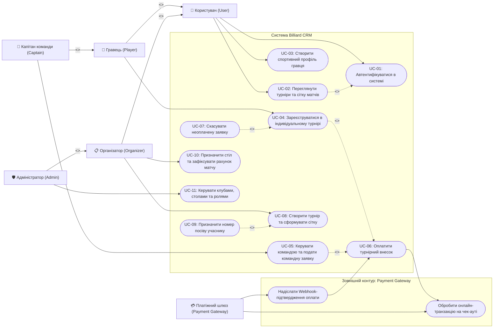

# Відповідь моделі: Вимоги (EARS), сценарії (User Stories, Gherkin), Use Case діаграма та матриця трасування

Нижче наведено згенерований первинний комплект артефактів відповідно до специфікації `spec.md`.

---

## 1. Вимоги за синтаксисом EARS (`requirements.md`)

| ID | Тип EARS | Вимога |
|:---:|---|---|
| **REQ-01** | **Ubiquitous** (Постійна) | Система ПОВИННА перевіряти системну роль користувача (`users.role`) та контекстні зв'язки у базі даних перед виконанням будь-якої операції створення або модифікації даних. |
| **REQ-02** | **Event-driven** (Подієва) | КОЛИ користувач із роллю `ORGANIZER` або `ADMIN` створює новий турнір у обраному клубі (`club`), система ПОВИННА зберегти запис `tournament` і призначити користувача відповідальним директором (`director_id`). |
| **REQ-03** | **Event-driven** (Подієва) | КОЛИ `Player` або `Captain` подає заявку на турнір до настання дедлайну, система ПОВИННА створити запис `registration` зі статусом очікування оплати. |
| **REQ-04** | **Unwanted behaviour** (Небажана ситуація) | ЯКЩО `Player` або `Captain` намагається подати заявку після настання дедлайну реєстрації, ТО система ПОВИННА відхилити запит і повернути повідомлення про закриття реєстрації. |
| **REQ-05** | **Event-driven** (Подієва) | КОЛИ від зовнішньої системи `Payment Gateway` надходить асинхронний Webhook про успішну транзакцію, система ПОВИННА змінити `payment_status` заявки на `'PAID'` та допустити учасника до турнірної сітки. |
| **REQ-06** | **Unwanted behaviour** (Небажана ситуація) | ЯКЩО `Payment Gateway` повертає помилку списання або тайм-аут транзакції, ТО система ПОВИННА залишити заявку в неоплаченому статусі та надати учаснику можливість повторної оплати до дедлайну. |
| **REQ-07** | **State-driven** (Станова) | ПОКИ турнір перебуває в активному стані, система ПОВИННА дозволяти організатору призначати матчі виключно на більярдні столи (`billiard_table`) зі статусом `'AVAILABLE'` та переводити задіяний стіл у статус `'OCCUPIED'`. |
| **REQ-08** | **State-driven** (Станова) | ПОКИ триває матч, система ПОВИННА дозволяти організатору оновлювати поле `match.score` та фіксувати переможця після завершення гри. |
| **REQ-09** | **Optional feature** (Опційна) | ДЕ регламент турніру передбачає розсіювання учасників за рейтингом, система ПОВИННА дозволяти організатору задавати номер посіву під час формування сітки. |
| **REQ-10** | **State-driven / NFR** (Нефункціональна) | ПОКИ триває турнір, система ПОВИННА швидко оновлювати стан турнірної сітки та рахунок матчів для до 1000 одночасних користувачів. |
| **REQ-11** | **Event-driven** *(Непокрита / Out-of-scope)* | КОЛИ турнір завершується, система ПОВИННА автоматично перераховувати індивідуальний рейтинг `player.rating` за формулою ELO та присвоювати новий спортивний розряд `sports_title`. *(Свідомо не покрито Use Cases поточного релізу: формула коефіцієнтів ELO та правила присвоєння звань залежать від зовнішнього регламенту федерації та винесені в беклог).* |

---

## 2. User Stories та Gherkin-сценарії

Згенеровано 6 User Stories (`US-01`..`US-06`) для ролей `User`, `Player`, `Captain`, `Organizer`, `Admin` та розписано два повнотекстові функціональні блоки в синтаксисі Gherkin (`# language: uk`) із використанням `Передумова`, `Правило`, `Сценарій` та `Структура сценарію` + `Приклади` (збережено у файлі `requirements.md`).

---

## 3. Use Case діаграма (`model.mmd`)

---

## 4. Матриця трасування (`requirements.md`)

Побудовано таблицю трасування M:N між `REQ-01`..`REQ-11` та `UC-01`..`UC-11` із виділенням наскрізної вимоги `REQ-01` та непокритої вимоги `REQ-11`.
