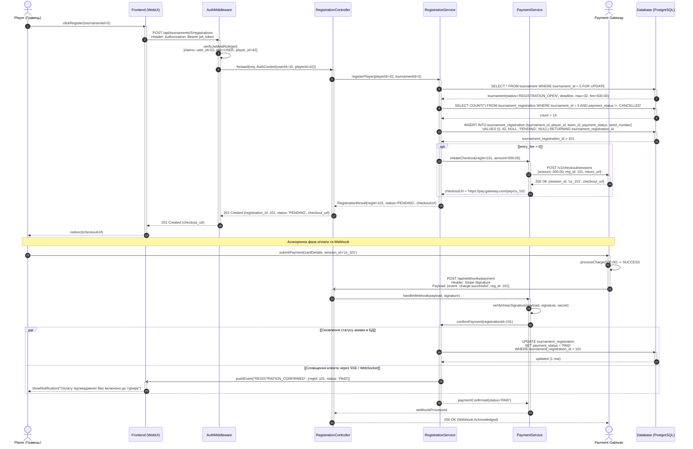
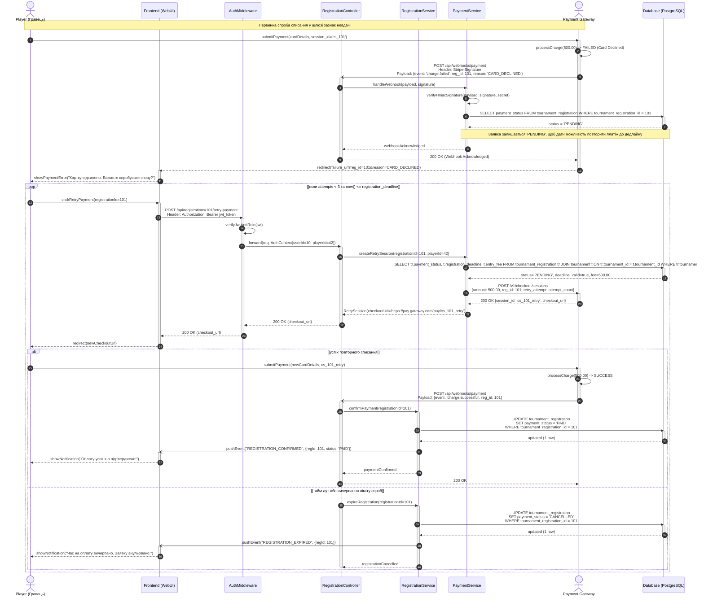
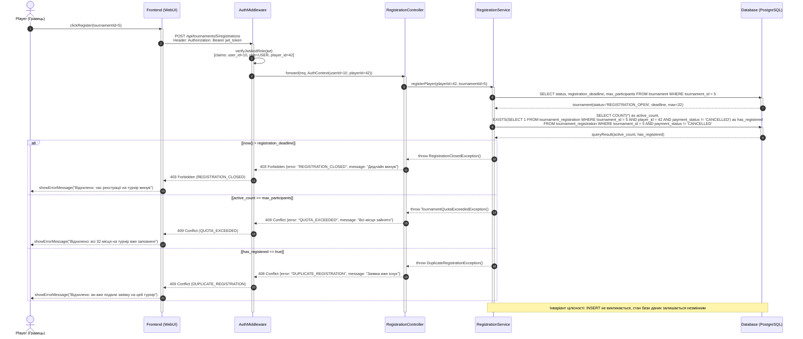

# Відповідь моделі: Генерація Sequence-діаграм для прецеденту онлайн-реєстрації

Відповідно до специфікації `spec.md` згенеровано декларативні моделі Sequence-діаграм у синтаксисі Mermaid для трьох сценаріїв прецеденту `UC-04` (Реєстрація на індивідуальний турнір) з включенням `UC-06` (Оплата внеску).

---

## 1. Сценарій 1 (Happy Path): Успішна реєстрація з онлайн-оплатою (`model/model-01-success.mmd`)

---

## 2. Сценарій 2 (Alternative / Retry): Помилка списання коштів та повторна спроба (`model/model-02-payment-failure.mmd`)

---

## 3. Сценарій 3 (Exception / Validation): Відхилення заявки через порушення інваріантів (`model/model-03-validation-error.mmd`)

