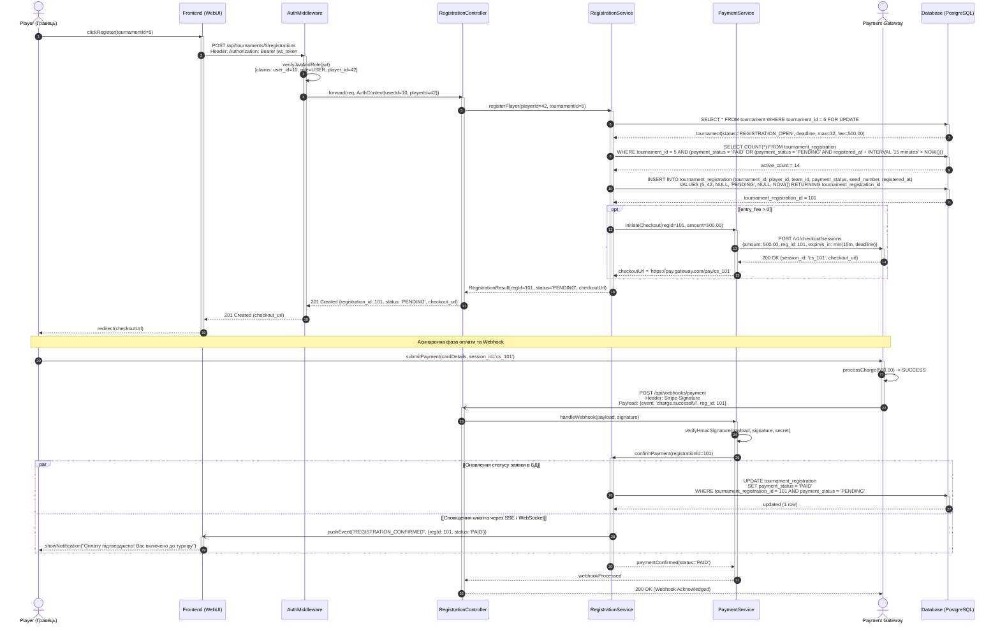
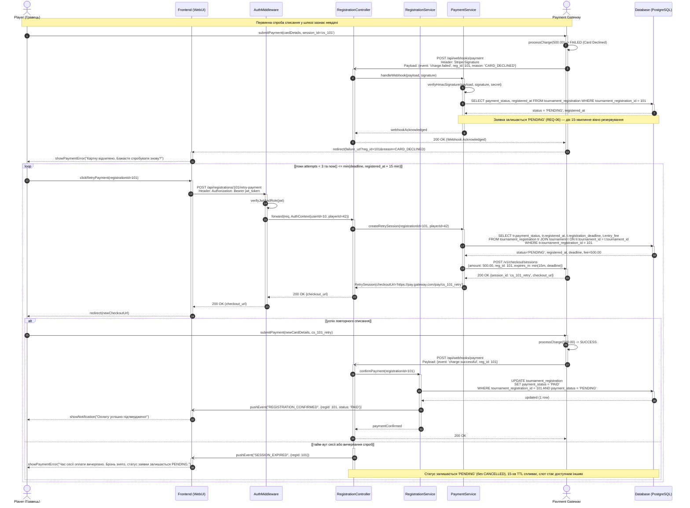
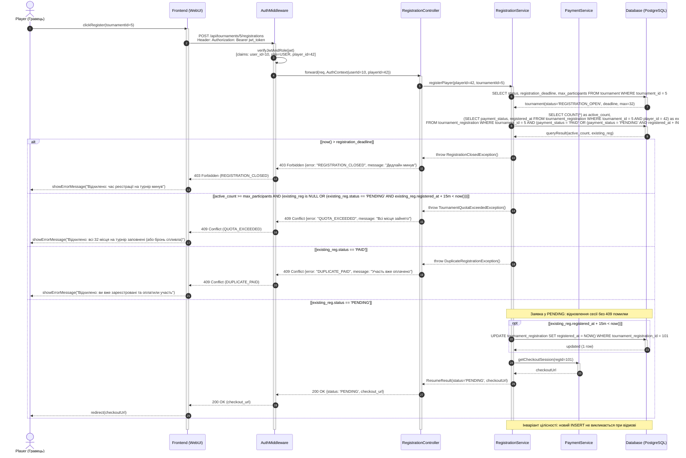

# Відповідь моделі: Регенерація Sequence-діаграм після інженерного аудиту

На основі зауважень аудиту ([ai/01-feedback-sequence.md](./01-feedback-sequence.md)) та результатів уточнюючого інтерв'ю ([ai/02-prompt-sequence.md](./02-prompt-sequence.md)):

1. **Виправлено галюцинацію статусу `payment_status`:**
   - Повністю вилучено неіснуючий статус `'CANCELLED'`.
   - У скоупі взаємодії використовуються виключно валідні значення ENUM із Лабораторної №1: `'PENDING'` та `'PAID'`.
   - При вичерпанні спроб оплати чи тайм-ауті сесії статус залишається `'PENDING'` у БД (відповідає вимозі REQ-06), а слот автоматично вивільняється після 15 хвилин за правилом TTL.
2. **Впроваджено 15-хвилинне вікно резервування (Slot Hold TTL):**
   - Розрахунок зайнятих місць враховує лише оплачені або актуальні броні:
     `SELECT COUNT(*) FROM tournament_registration WHERE tournament_id = 5 AND (payment_status = 'PAID' OR (payment_status = 'PENDING' AND registered_at + INTERVAL '15 minutes' > NOW()))`.
   - Час броні суворо обмежується дедлайном турніру: $\min(15\text{ хв}, \text{час до дедлайну})$.
3. **Уточнено логіку валідації дублікатів (Сценарій 3):**
   - Помилка `409 Conflict` повертається лише у разі, якщо гравець уже оплатив турнір (`payment_status == 'PAID'`).
   - Якщо статус `'PENDING'` і бронь активна ($\le 15$ хв) — система повертає `200 OK` з існуючим посиланням на оплату.
   - Якщо статус `'PENDING'`, але бронь спливла ($> 15$ хв) — система перевіряє вільні місця: якщо є, оновлює `registered_at = NOW()` та повертає нову платіжну форму; якщо місць немає — повертає `409 Conflict («Бронь вичерпано, вільних місць немає»)`.
4. **Очищено кореневу структуру:**
   - Видалено депрекейтовані файли `model.mmd` та `render.png` у корені. Усі актуальні артефакти розміщено у `model/` та `render/`.

---

## 1. Сценарій 1 (Happy Path): `model/model-01-success.mmd`

---

## 2. Сценарій 2 (Alternative / Retry): `model/model-02-payment-failure.mmd`

---

## 3. Сценарій 3 (Exception / Validation): `model/model-03-validation-error.mmd`

