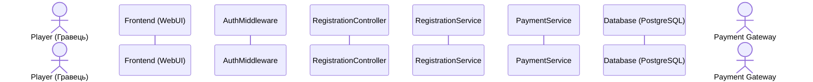

# Відповідь моделі: Групування внутрішніх модулів та винесення зовнішнього актора (Ітерація 4)

Для дотримання архітектурної чистоти та усунення перетинів ліній життя між внутрішніми сервісами й зовнішніми системами:
1. **Внутрішні компоненти системи** згруповано послідовно за шарами архітектури:
   `Frontend (WebUI)` $\rightarrow$ `AuthMiddleware` $\rightarrow$ `RegistrationController` $\rightarrow$ `RegistrationService` $\rightarrow$ `PaymentService` $\rightarrow$ `Database (PostgreSQL)`.
2. **База даних (`Database`)** виступає останнім внутрішнім шаром зберігання даних.
3. **Зовнішній актор (`Payment Gateway`)** перенесений на крайню праву межу діаграми після бази даних.

---

## Оновлений блок оголошення учасників (`model-01-success.mmd` та `model-02-payment-failure.mmd`)

Ця зміна уніфікує порядок учасників з моделлю Сценарію 3 (`model-03-validation-error.mmd`), де внутрішні шари також завершуються `Database (PostgreSQL)`.
